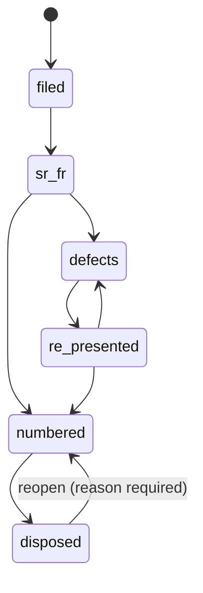

# 0016. Proceeding state machine and canonical next-date rules

## Status

Proposed

## Date

2026-10-21

## Context

A proceeding in an Indian court moves through a pre-numbering lifecycle before it gets a case number: it is filed, receives SR/FR numbers, may be returned with defects and re-presented, is numbered, and is finally disposed. Sometimes it is reopened (a restoration or review). The schema ([ADR 0013](0013-matter-graph-schema.md), #346) stores only the current `proceeding.state` and `state_changed_at`. The matter graph (#33, spike §5, architecture §2.3) needs one place that decides which moves are legal, keeps the history of the moves for the cross-proceeding timeline (#33 part 5), and hands the registry's cure deadline to the obligation service (#67). This ADR records the state machine (#363, #33 part 2) and the canonical next-date rules (#364, #33 part 3).

The schema allows one canonical listing per proceeding (`listing_one_canonical_uq`, unique `(workspace_id, proceeding_id) WHERE canonical`). That listing is the next date the lawyer acts on. Dates arrive from many sources (manual entry, cause lists, documents, AI), and they can disagree. The [technical architecture spike](../engineering/13-technical-architecture-spike.md) §5 and the zero-entry automation design §4.2 and §5 require that a person decide between conflicting sources, and that the services never pick one silently.

## Decision drivers

- A state change must never erase what came before: the SR, FR and diary numbers stay after numbering, and every move is kept.
- Services emit events through the `GraphEvents` port and never call the obligation, audit or notification code themselves.
- A state change is a lawyer's (or a confirmed source's) act. An unconfirmed suggestion is a proposal (#47), not a state change.
- Nothing may cross a workspace boundary: another workspace's proceeding is NOT_FOUND.
- A canonical next date must never change without a member confirming it, and when two sources give different dates both stay visible.
- The swap must respect the immediate partial unique index and never leave a proceeding with two canonical listings, and the rule must be machine-checked so a later module cannot write `listing.list_date` around it.

## Considered options

| Option                                                                       | Verdict  | Reason                                                                                                                                                   |
| ---------------------------------------------------------------------------- | -------- | -------------------------------------------------------------------------------------------------------------------------------------------------------- |
| Transition table in core, append-only `proceeding_state_change`              | Chosen   | One writer of `proceeding.state`; the table is testable as a pure function; history serves the timeline and audit                                        |
| Transition rules as a database trigger                                       | Rejected | Reasons, actors and cure deadlines would have to reach the trigger through session settings; harder to test                                              |
| Derive the history from `audit_event`                                        | Rejected | Audit attaches to the event port elsewhere and may be filtered; the timeline needs the graph's own record                                                |
| One service module (`next-date.ts`) plus a source-scanning architecture test | Chosen   | It runs in every test run, catches Drizzle and raw SQL, and follows the judge-aggregation and access-mode guards                                         |
| An ESLint rule in `packages/config/eslint/rules/`                            | Rejected | It needs plugin wiring and fixtures, misses raw SQL in template strings unless it re-parses them, and is only linted in CI (locally, changed files only) |
| A database trigger refusing canonical `list_date` updates                    | Rejected | The application role must still swap the flag, so the trigger could not tell a confirmed swap from a direct write without session flags the services set |

## Decision

States (`proceeding_state`): `filed`, `sr_fr`, `defects`, `re_presented`, `numbered`, `disposed`.

- `transitionProceeding(deps, actor, { proceedingId, to, reason?, number?, year?, cureDeadline?, provenance? })` in `packages/core/src/matter-graph/state-machine.ts` is the only writer of `proceeding.state`. It allows exactly the eight moves above (`PROCEEDING_TRANSITIONS`). Every other of the 36 ordered pairs, and a reopen without a non-blank reason, throws `InvalidTransitionError` (a `WorkspaceError` with code `CONFLICT`, carrying `from` and `to`). `assertTransition` is the pure form, covered by a fast-check property test.
- Moving to `numbered` (the reopen included) takes `number` and `year` in the same call. They are normalised as on create, and an existing identity is `CONFLICT`. `sr_no`, `fr_no`, `diary_no` and `filing_no` are never written by a transition.
- Entering `defects` may carry the registry's `cureDeadline` (a date). It is stored on the history row and returned in the event payload, so the obligation service can create the cure-deadline obligation. A cure deadline with any other target is VALIDATION.
- Every transition locks the proceeding row, sets `state` and `state_changed_at`, appends one `proceeding_state_change` row (`from_state`, `to_state`, `reason`, `actor_member_id`, `cure_deadline`, `changed_at`, provenance) and emits `proceeding.state_changed` with `{ from, to, reason, actor, provenance }` (plus `cureDeadline` when set and the matter's `sensitive` flag) after the transaction commits.
- `confirmation_state` on the history row comes from the caller's provenance and defaults to `confirmed`. `proposed` is rejected at input: the acting member confirms every state change.
- Access follows the proceeding's matter: `matter.write` to move it, with the role taken from the membership. A proceeding outside the actor's workspace is NOT_FOUND.
- `proceeding_state_change` (migration 0043) is a tenant table under FORCE RLS. Its rows cascade with their proceeding, `actor_member_id` is `ON DELETE SET NULL (actor_member_id)`, and CHECKs mirror the rules (no same-state rows, cure deadline only into `defects`, reopen with a reason). It is exported with the matter graph and purged on workspace erasure.

### Next-date rules

- `proposeNextDate(deps, actor, {proceedingId, date, provenance})` (packages/core/src/matter-graph/next-date.ts) needs `matter.write` and never changes the canonical listing:
  - with no canonical listing it stores a non-canonical `proposed` listing and returns `{kind: 'proposal', listingId}`; proposing the same date again returns the earlier proposal;
  - with a canonical listing of the same date it returns `{kind: 'noop'}` and writes nothing;
  - with a canonical listing of another date (whatever its confirmation state) it stores the proposed side as its own non-canonical listing and returns `{kind: 'conflict', current, proposed}`. The services never choose between them.
- `confirmNextDate(deps, actor, {listingId, allowPast?})` is the only path that makes a listing canonical. It needs a member with `matter.write`; the role comes from the membership row. It refuses a date before today in Asia/Kolkata unless `allowPast: true` is passed explicitly. In one transaction it locks and clears the old canonical row, which stays as history with `canonical = false`, and then sets `canonical = true, confirmation_state = 'confirmed'` on the target. A concurrent swap that hits the index is `CONFLICT`.
- `getCanonicalNextDate` reads the canonical listing with `matter.read`.
- Events: `listing.next_date_proposed`, `listing.next_date_conflict` and `listing.next_date_confirmed` (with `previousListingId`). Each carries the matter's `sensitive` flag.
- `no-direct-listing-update` (`packages/core/src/matter-graph/__tests__/no-direct-listing-update.test.ts`) fails the build if any packages/core module other than `next-date.ts` updates `listDate`/`canonical`, inserts a listing with `canonical`, or runs raw SQL updating `list_date`/`canonical`. Deleting listing rows (the lifecycle erase) stays allowed.

## Consequences

- Positive: one tested place decides proceeding moves; the timeline and audit can read an append-only history; the obligation service reacts to an event instead of being called.
- Positive: the matter timeline (`getMatterTimeline`, #366) reads `proceeding_state_change` for its `state_change` events, so state moves appear next to listings, orders and obligations.
- Positive: SR/FR/diary numbers survive numbering, so a proceeding stays findable by every identifier it ever had.
- Negative: a state imported in bulk (e.g. a migration from another tool) has to replay legal transitions, or be written by a reviewed data migration outside the service.
- Negative: a reopen asks the caller to repeat the number and year it already had.
- Positive: a next date changes only through a recorded confirmation, conflicts stay visible, and the history of earlier next dates is kept.
- Negative: every next-date proposal adds a listing row, and future writers of listing details (court-day, #58) must keep away from `list_date` and `canonical` or go through `next-date.ts`.

## Revisit when

- A court's lifecycle needs a state or move outside this table (for example a transfer between forums).
- A writer outside packages/core (an adapter or a worker job) needs to write listings directly; the next-date guard then has to cover that package.
- Undo storage for confirmations (#47) needs the swap to return an `UndoPayload`.
- Automation (#47) needs to propose state changes: proposals then live in #47's store and become state changes here only once confirmed.

## Links

- [ADR 0013: Matter-graph schema](0013-matter-graph-schema.md)
- [Technical architecture spike](../engineering/13-technical-architecture-spike.md)
- Issues #33, #363, #364, #67, #47
