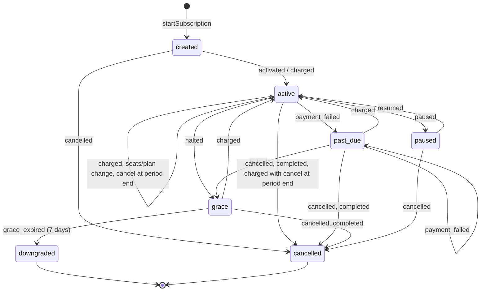

# Billing

`packages/billing` holds CauseDeck's own SaaS billing (#28, PRD PL-3, architecture §6.5): the plan
catalogue, the subscription state machine, seat proration, the `BillingProvider` contract with a
deterministic mock and the Razorpay adapter, and the daily reconcile. It bills workspaces for
CauseDeck only. The system never takes payments for an advocate's clients, and no card or bank
data touches our servers: customers authorise through Razorpay's hosted UPI Autopay mandate link.

Dev and CI need no credentials: `BILLING_PROVIDER` defaults to `mock`.

| Import | What |
|---|---|
| `@causedeck/billing` | Barrel, safe in `apps/web`: plans, GSTIN, proration, state machine |
| `@causedeck/billing/plans` | `PLAN_CATALOGUE`, `checkPlanConfig`, `mandateChargeNotice`, the UPI mandate cap |
| `@causedeck/billing/state-machine` | `TRANSITIONS`, `transition`, `applyProviderEvent`, `fromSubscriptionRow` |
| `@causedeck/billing/proration` | `prorateSeatIncrease` |
| `@causedeck/billing/service` | `createBillingService` (start, change seats, cancel, resume). Never touches the database |
| `@causedeck/billing/provider` | `createBillingProvider(env)`, the mock and Razorpay providers. Server-only |
| `@causedeck/billing/reconcile` | `reconcileSubscriptions` for the daily reconcile. Server-only |
| `@causedeck/billing/webhook` | Razorpay signature verify/sign, replay window, `minimiseWebhookEvent`, `webhookSecretFor`, `MOCK_WEBHOOK_SECRET`. Server-only |

## State machine

`packages/billing/src/state-machine.ts` is pure: `transition(snapshot, event, now)` returns the
next snapshot, and a move missing from `TRANSITIONS` throws `IllegalTransitionError`. Provider
webhooks map to events through `fromProviderEvent` (`subscription.pending` and `payment.failed`
are both `payment_failed`; `payment.captured` changes nothing because the charge arrives as
`subscription.charged`).

`seats_changed`, `plan_changed` and `cancelled` are legal from `created`, `active`, `past_due` and
`grace`. `downgraded` and `cancelled` are terminal: the workspace starts a new subscription.

The `subscription.status` column stores the state as:

| State | `status` |
|---|---|
| `created` | `trialing` |
| `active` | `active` |
| `past_due` | `past_due` |
| `grace` | `past_due` with `grace_until` set |
| `paused` | `paused` |
| `cancelled` | `cancelled` |
| `downgraded` | `expired` |

## Proration

`packages/billing/src/proration.ts`, all in integer paise with bigint arithmetic:

- **Seat increase mid-cycle:** charged immediately for the rest of the period. Per line (paid
  seats, clerk seats): `round_half_up(added seats × unit price × remaining seconds / period
  seconds)`. Each line is rounded on its own, then the lines are summed. The time basis is the
  actual period in whole seconds, so 28/29/30/31-day months and leap years are exact.
- **Seat decrease:** never refunded. It is scheduled at the provider for the next cycle
  (`pendingSeats`) and applied on the next `subscription.charged`.
- **Plan change:** `plan_changed` keeps the state and records the new plan id. The billing
  service has no plan-change operation yet, so nothing is prorated for it.
- The prorated `charge` is returned to the caller and collected by invoicing (#29).

## Dunning

The policy is pure, in `packages/billing/src/dunning.ts` (`planDunning`); the daily
`system.billing.dunning-tick` job (`packages/core/src/jobs/definitions/billing-dunning-tick.ts`,
04:30 IST) carries it out.

| Day (from the first failure) | What happens | Notice stage |
|---|---|---|
| 0 | `payment.failed` / `subscription.pending` moves the subscription to `past_due` | `payment_failed` |
| 1, 3, 5, 7 (`DUNNING_RETRY_DAYS`) | Payment retry through the provider (`retryPayment`) | `retry_1` … `retry_4` |
| 8 (`DUNNING_HALT_DAY`), still unpaid | `halted` → `grace`, `grace_until` = now + `GRACE_PERIOD_DAYS` (7); full access | `grace_started` |
| `grace_until` | `grace_expired` → `downgraded` (stored status `expired`): read-only Junior limits | `downgraded` |

- **Episode.** `billing.process-event` sets `subscription.dunning_started_at` (and
  `dunning_attempts = 0`) when a subscription enters `past_due` or `grace`, keeps both while it
  stays there, and clears them when it leaves (a `subscription.charged` back to `active`, a
  cancellation). The tick records each retry in `dunning_attempts` (0..4). A late tick makes one
  retry, the latest one due, never several.
- **Provider halt.** If Razorpay halts the subscription first (`subscription.halted`), grace
  starts from that halt and the tick only watches `grace_until`.
- **Retries.** The mock's `retryPayment` raises `subscription.charged` or `payment.failed`
  (`setRetryOutcome`; failed by default). Razorpay has no merchant API to retry a subscription
  charge: it retries a `pending` subscription itself. So the Razorpay adapter makes no write call
  and returns `provider_scheduled`. Either way, the subscription changes only when the webhook
  arrives.
- **Notices.** Each stage sends a `billing.notice` (#23; in-app and email by default) to every active
  owner (the only role with `billing.manage`), linking to `/w/<slug>/settings/billing`. The
  `dedupeKey` is `billing.dunning:<subscription id>:<dunning_started_at ms>:<stage>`, so a rerun
  sends nothing twice and a new episode notifies again. The copy carries no amounts.
- **Targets.** The tick has no workspace, so it lists `past_due` subscription ids (which includes
  grace) through the SECURITY DEFINER `app_billing_dunning_targets()` (`0015_billing_dunning`).
  Then it works on each one inside `withWorkspace` with the row locked. If one workspace fails
  (for example, a provider error), the attempt is not counted and the tick moves on.
- **No deletion.** Dunning only updates the subscription row and inserts notifications. A
  downgraded workspace keeps all its data, read-only; a new subscription restores access.
  Entitlements are invalidated after each change.

## SaaS invoices

The GST tax invoices CauseDeck issues to workspaces (#29) live in
`packages/db/src/schema/saas-invoice.ts`, created by `0016_saas_invoices`. They are prefixed `saas_`
so they never collide with the client-fee `invoice` tables, which are legal-gated and separate. A
naming test fails if 0016 creates any other table.

- `saas_invoice` and `saas_invoice_line` are tenant tables under FORCE RLS. A line references its
  invoice through the composite `(invoice_id, workspace_id)` foreign key, so it cannot point into
  another workspace. `subscription_id` has no foreign key: an issued invoice outlives its
  subscription.
- `invoice_counter(series, fy, last_number)` is global (`GLOBAL_TABLES`): one gapless series per
  supplier series and financial year. Numbers are allocated under a row lock (#253).
- **Issued invoices are immutable: void and reissue only.** The `saas_invoice_immutable` trigger
  rejects (SQLSTATE 42501) any update of a non-draft invoice that changes a column other than
  `status` and `pdf_blob_id`, or moves it back to `draft`. The `saas_invoice_line_immutable`
  trigger rejects inserting or updating lines of a non-draft invoice. Deletes are not blocked, so
  deleting a workspace still cascades.

## Test prices

Placeholder prices to validate pricing, kept as data in `packages/billing/src/plans.ts` (seeded by
`packages/db/src/seed/plans.ts`) so they change without code changes. All amounts are ex-GST;
18% GST (`GST_RATE_BPS = 1800`) is added on the invoice (#29). The snapshot test in
`packages/billing/src/__tests__/plans.test.ts` pins them.

| Plan id | Plan | Price (Rs) | Paise | Notes |
|---|---|---|---|---|
| `junior` | Junior | 0 | 0 | Free; 15 active matters, fair-use caps |
| `advocate-monthly-1` / `-2` / `-3` | Advocate (monthly) | 499 / 799 / 1,199 per month | 49,900 / 79,900 / 119,900 | |
| `advocate-annual-1` / `-2` / `-3` | Advocate (annual) | 4,990 / 7,990 / 11,990 per year | 499,000 / 799,000 / 1,199,000 | 10 × monthly |
| `chamber-seat-1` / `-2` / `-3` | Chamber | 499 / 649 / 899 per seat per month | 49,900 / 64,900 / 89,900 | Minimum 3 seats |
| clerk seat (chamber) | Clerk seat | 199 per seat per month | 19,900 | `CLERK_SEAT_PRICE_PAISE` |

## UPI Autopay mandate cap

UPI Autopay e-mandates debit up to Rs 15,000 per charge without the payer authenticating each
charge (`UPI_AUTOPAY_MANDATE_CAP_PAISE = 1_500_000`). A larger charge needs the payer to approve
it in their UPI app every time.

- **Plan config check:** `checkPlanConfig()` flags a fixed-price plan whose charge is above the
  cap (`upi-mandate-cap-exceeded`) and notes, for each per-seat plan, the most paid seats whose
  charge stays within it (`upi-mandate-cap-seats`). With the test prices no fixed plan is over the
  cap (the largest, `advocate-annual-3`, is Rs 11,990); chamber charges cross it above 30 seats
  (band 1), 23 seats (band 2) or 16 seats (band 3), counting clerk seats in the same charge.
- **Mandate flow copy:** `mandateChargeNotice(plan, { seats, clerkSeats })` returns one cycle's
  `chargePaise` and `requiresAdditionalAuth`. When it is true, the mandate and upgrade flow shows
  the copy at `MANDATE_ADDITIONAL_AUTH_MESSAGE_KEY` (`billing.mandate.additionalAuth.title` and
  `.body` in `packages/i18n/src/messages/*/settings.json`, ICU argument `{amount}` = the formatted
  cap, Rs 15,000) before sending the customer to the mandate link. The billing UI that renders it
  is #29.

## Secrets and the boot guard

- `RAZORPAY_SECRET` (the API key secret) and `RAZORPAY_WEBHOOK_SECRET` are parsed into `Secret`
  (`@causedeck/config/env`, #4). They print as `[REDACTED]` in logs, JSON and errors; only the SDK
  constructor (`createRazorpayProvider`) and, from #204, webhook signature verification call
  `.reveal()`.
  `RAZORPAY_KEY_ID` is not secret.
- With no billing keys set, `BILLING_PROVIDER` defaults to `mock` and the app boots.
- `BILLING_PROVIDER=razorpay` requires all three keys; a missing one fails boot naming the key,
  never echoing a value.
- In production, `BILLING_PROVIDER=mock` fails boot unless `ALLOW_MOCK_PROVIDERS=true` (meant for
  staging demos only). Tests: `packages/billing/src/__tests__/provider-select.test.ts`,
  `packages/config/src/env/__tests__/schema.test.ts`.

## Webhooks

`POST /v1/webhooks/razorpay` (`apps/api/src/routes/webhooks/razorpay.ts`, #204) is public: Razorpay
authenticates by signing the raw body. Register this URL in the Razorpay Dashboard for the
subscription and payment events. The handler only verifies, stores and queues:

1. The raw body is read before parsing. A missing or wrong `X-Razorpay-Signature` (hex
   HMAC-SHA256 with `RAZORPAY_WEBHOOK_SECRET`, compared with `crypto.timingSafeEqual`) is a 400.
2. A missing `x-razorpay-event-id`, a body that is not a Razorpay event, or a `created_at` outside
   the replay window (72 h old to 5 min ahead) is a 400.
3. The workspace comes only from the stored provider subscription id, through the SECURITY
   DEFINER function `app_billing_workspace_for_provider_subscription(provider, id)`
   (`0011_billing_webhook`, ids only). Notes and other payload metadata are never used. An unknown
   subscription gets a 200 and is ignored (logged as `billing webhook for an unknown subscription
   ignored`).
4. The minimised event (`minimiseWebhookEvent`: no email, contact, description or notes) is stored
   in `billing_event.payload`, once per event id. A replay is a 200 `{ received: true, duplicate:
   true }` with no side effects. A new event enqueues `billing.process-event`
   (`{ workspaceId, providerEventId }`) in the same transaction, so a failed enqueue rolls the row
   back and Razorpay's retry is processed.

`billing.process-event` (`packages/core/src/jobs/definitions/billing-process-event.ts`) locks the
`billing_event` row, skips it if `processed_at` is set, applies the event to the subscription with
`applyProviderEvent`, sets `processed_at` and invalidates the entitlement cache. An event the state
machine rejects is marked processed and logged (`billing event rejected by the state machine`),
never retried. The entitlement cache is per process: the worker clears its own, and the API's
expires with the cache ttl.

Dev and CI run the mock provider: `webhookSecretFor(env)` returns `MOCK_WEBHOOK_SECRET` when
`BILLING_PROVIDER=mock`, and `signMockDelivery(delivery)` from `@causedeck/billing/provider` gives
the exact raw body and signature for a mock delivery. Tests:
`packages/billing/src/__tests__/webhook-signature.test.ts`,
`packages/core/src/jobs/definitions/billing-process-event.test.ts`,
`apps/api/src/__tests__/razorpay-webhook.test.ts`.

### Read API

- `GET /v1/billing/plans` (signed in): the active catalogue (`id`, `name`, `kind`, `interval`,
  `pricePaise`, `perSeat`, `clerkSeatPricePaise`, `minSeats`).
- `GET /v1/billing/subscription` (signed in, member of the `x-workspace-id` workspace): the current
  subscription or `null`. Provider ids, GSTIN and the billing email are never returned.

## Webhook secret rotation

Razorpay signs each webhook with the endpoint's secret (`X-Razorpay-Signature`, HMAC-SHA256);
the webhook route (#204) verifies it with `RAZORPAY_WEBHOOK_SECRET` in constant time. A webhook has
one secret at a time, so rotate like this:

1. Generate a new random secret (at least 32 bytes) and store it in the secret manager as the
   pending value of `RAZORPAY_WEBHOOK_SECRET` (#111).
2. In the Razorpay Dashboard (Settings → Webhooks), edit the CauseDeck webhook and set the new
   secret, then deploy the new value straight away.
3. Deliveries signed with the new secret before the deploy finishes are rejected with 400.
   Razorpay retries failed deliveries, and processing is idempotent by `x-razorpay-event-id`, so
   the retries apply once the new secret is live. The next daily reconcile reports anything still
   out of step.
4. Remove the old value. Rotate immediately if the secret may have leaked, and on any staff
   change with access to it.

The API key secret (`RAZORPAY_SECRET`) rotates the same way: generate a new key in the Dashboard,
deploy `RAZORPAY_KEY_ID` and `RAZORPAY_SECRET` together, then revoke the old key.

## Daily reconcile

`system.billing.reconcile` (`packages/core/src/jobs/definitions/billing-reconcile.ts`) runs daily
at 04:00 IST. It lists every current (not cancelled or expired) subscription that has a provider
id through the SECURITY DEFINER function `app_billing_reconcile_targets()` (ids only,
`0007_billing_reconcile`), reads each row inside `withWorkspace`, calls only
`provider.fetchSubscription`, and logs one `warn` per discrepancy (`billing reconcile
discrepancy`) plus a summary `info` (`billing reconcile complete`, `{ checked, discrepancies }`).

| `field` | Meaning |
|---|---|
| `status` | Local `status` differs from the provider status (`created`/`authenticated` = `trialing`, `pending`/`halted` = `past_due`, `completed` = `cancelled`) |
| `seats` | Local paid seats differ from the provider quantity |
| `current_period_end` | Period end differs (compared to the second) |
| `cancel_at_period_end` | Cancel-at-period-end flags differ |
| `missing_at_provider` | The provider does not know the subscription id |
| `fetch_failed` | Any other provider error (logged by error code only) |

It never mutates: no database writes and no provider call besides `fetchSubscription`. Logs carry
ids and the compared values only, never the billing email, GSTIN, payloads or secrets. A
discrepancy usually means a missed or failed webhook: check the webhook deliveries in the Razorpay
Dashboard and redeliver the event, which the idempotent webhook route applies once. Do not edit
`subscription` rows by hand.

## Switching to live

1. Get the live Razorpay key id, key secret and webhook secret (#111) into the secret manager.
2. Create one Razorpay plan per paid catalogue row (same amount in paise and interval) and pass
   their ids to `createBillingService({ providerPlanId })`. The mock accepts catalogue ids as-is.
3. Register the API's Razorpay webhook route (#204) in the Dashboard for the subscription and
   payment events, with the webhook secret.
4. Set `BILLING_PROVIDER=razorpay`, `RAZORPAY_KEY_ID`, `RAZORPAY_SECRET` and
   `RAZORPAY_WEBHOOK_SECRET`, and leave `ALLOW_MOCK_PROVIDERS` unset. Boot fails if any key is
   missing.
5. Run one end-to-end subscription with a test-mode key first, then check that the next daily
   reconcile logs `billing reconcile complete` with no discrepancies.
