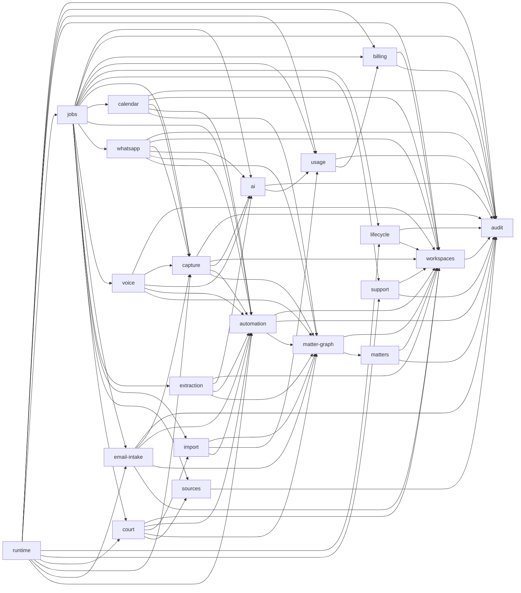

# Core domains

`@causedeck/core` is one package split into domains (#293): one folder each under
`packages/core/src/`. A domain exposes a public `index.ts`, and other domains import it only
through that file and only along the edges in the dependency map below. ESLint enforces this with
`causedeck/core-domain-boundaries` (`packages/config/eslint/rules/core-domain-boundaries.js`), and
`packages/core/src/domains.test.ts` checks the layout. When core splits into separate packages is
decided in [ADR 0012](../adr/0012-core-package-split-threshold.md).

```sh
pnpm --filter @causedeck/config exec vitest run test/core-domain-boundaries.test.ts test/eslint-boundaries.test.ts
pnpm --filter @causedeck/core exec vitest run src/domains.test.ts
```

## Domains

| Folder | Public entry point | What |
|---|---|---|
| `audit` | `@causedeck/core/audit` | audit writer, chain verification, feed query and export ([audit.md](audit.md)) |
| `workspaces` | `@causedeck/core/workspaces` | workspaces, members, invitations, offboarding ([workspaces.md](workspaces.md)) |
| `matters` | `@causedeck/core/matters` | matter restrictions |
| `court` | `@causedeck/core/court` | forum catalogue reads, custom workspace forums and official deep links (#34, [ADR 0014](../adr/0014-forum-catalogue-and-deep-links.md)), the tenant-free adapter parse-health summary (#372), and the courts read models `getCourtsIndex`, `getForumDetail`, `getAdapterStatus` and `listHallsSeen` (#397; access-mode rows with counsel notes via `@causedeck/flags/access-mode`), the roster services (#385, #387), and bench-change detection and alerts `detectBenchChanges`, `listAlerts`, `dismissAlert` with the `CourtEvents` port (`bench.changed`) and `notify()` delivery (#389), and the rosters page read model `getRostersPage` (#434), and the KHC cause-list watches `addCauseListWatch`, `listCauseListWatches`, `removeCauseListWatch` and `pollCauseList` (#482: one fetch per list publication shared by every workspace, matched rows staged as L2 proposals) |
| `matter-graph` | `@causedeck/core/matter-graph` | matter-graph services (#362): matters, proceedings, documents, the duplicate finder, the proceeding state machine (#363, ADR 0016), the canonical next date (#364: propose, confirm, read; the only writer of `listing.list_date` and `canonical`), merges and splits with `UndoPayload` (#365) and their read-only previews (#392), the cross-proceeding matter timeline (#366, read-only), the matters read models (#386) and the document preview read model `getDocumentPreview` (#393: one page's text and the version chain, for `DocumentPreviewSheet`), and the `GraphEvents` port they emit through |
| `automation` | `@causedeck/core/automation` | the automation engine (#47, [ADR 0023](../adr/0023-automation-ladder-and-undo.md)): the L1-L4 ladder, the approval matrix as data and `decideLevel`, proposals (`submitProposals`, `acceptProposal`, `editAndAccept`, `dismissProposal`, `applyAutomatically`, `expireProposals`), the kind handlers that write through the matter-graph services, the 7-day cascading undo (`undoActivity`, `undoCapture`, `reassignCapture`), the ask-first dial, threshold learning, the activity feed read model (#49: `listActivities` keyset-paged with filters and search, `getActivityDetail`, `countByDay`, and `countDigestActivities` for the end-of-day digest; a row about a matter the member may not read is returned redacted, a clerk gets only `CLERK_ACTIVITY_KINDS`) and the activity export (owners the workspace, everyone else their own activity, audited as `audit.exported`). It has no send, file, pay or advise path (`scripts/check-no-l5.ts`) |
| `billing` | `@causedeck/core/billing` | entitlements, subscriptions, invoices ([billing.md](billing.md)) |
| `usage` | `@causedeck/core/usage` | metering, AI budget, fair use ([usage-metering.md](usage-metering.md)) |
| `ai` | `@causedeck/core/ai` | the AI gateway wiring (#44, [ADR 0022](../adr/0022-ai-gateway-implementation.md)): the ports `@causedeck/ai` declares, implemented on usage budgets, `workspace_settings.india_only_ai`, `matter.sensitive`, the `ai_call` writer and the 24 h `ai_call_result` store |
| `sources` | `@causedeck/core/sources` | the source registry (D-048): `policyFor` / `isCleared` fail closed, and audited staff changes to every external data source |
| `support` | `@causedeck/core/support` | consented, time-boxed staff support sessions and the read-only support context ([audit.md](audit.md)) |
| `capture` | `@causedeck/core/capture` | the capture inbox (#43, [ADR 0021](../adr/0021-capture-inbox-and-upload-pipeline.md)): `createCapture` / `completeUpload` / `createManualCapture`, per-channel opt-in, discard and pin, raw-object retention, `deleteRecording` (a voice recording and its transcript, #542), the diary-photo step of `capture.process` for channel `camera` (#52, [ADR 0030](../adr/0030-diary-photo-capture-and-image-anchors.md)), and the bodies of `capture.scan`, `capture.process` and `capture.retention`; jobs arrive as the `CaptureJobs` port. Not re-exported from the package root |
| `calendar` | `@causedeck/core/calendar` | calendar interop (#53, [ADR 0024](../adr/0024-ics-import-and-private-feed.md)): the private ICS feed (`createFeed` / `rotateFeed` / `revokeFeed`, the unauthenticated `serveFeed`) and the ICS import (`runIcsImport`, the `capture.process` body for channel `ics`, and its review). Pure parsing and rendering is `@causedeck/capture` `ics/`. Not re-exported from the package root |
| `email-intake` | `@causedeck/core/email-intake` | email forward-in intake (#54): the per-user intake address (`createAddress`, `rotateAddress`, `revokeAddress`, `getActiveAddress`, `resolveAddress` with no oracle), the sender allow-list (`addAllowlistEntry`, `removeAllowlistEntry`, `listAllowlist`) and `enableEmailChannel`, and the inbound side (#530): `receiveInboundEmail` (record once per message id, enqueue `email.intake`), `runEmailIntake` (the job body: sender trust, parser registry, captures, proposals) and `sweepExpiredRawMime`. Not re-exported from the package root |
| `extraction` | `@causedeck/core/extraction` | anchored order extraction (#46, [ADR 0028](../adr/0028-anchored-extraction.md)): `runOrderExtraction`, the body of the `extraction.extract-order` job. It reads a processed order or judgment, runs the deterministic pre-parse and (only where AI is allowed) the `extract_order` task, stores the validated extraction and its rejections (superseding, never deleting), stages proposals through automation and routes a capture that needs a person to "Needs you". Pure steps are `@causedeck/intelligence` `extract/`. Not re-exported from the package root |
| `whatsapp` | `@causedeck/core/whatsapp` | the WhatsApp chat import (#526, PRD CA-6): `receiveWhatsAppImport` (the `whatsapp_export` intake: `validateSelection` re-applied server-side, selected messages only, audio never transcribed) and `runWhatsAppImport` (the `whatsapp.import` job body: the `structure_chat` task on internal chats only, proposals anchored to the source message, the 30-day raw-text clock). Parsing, rules and the pure structuring are `@causedeck/capture` `whatsapp/`. Not re-exported from the package root |
| `import` | `@causedeck/core/import` | the bootstrap import plan engine (#57 part 2, #548): `getAdvocateIdentifiers`, the matched-only `filterMatchedRows` (a row that does not match the advocate is counted and never stored or logged), `clusterProceedings` (parent/child, connected batches, appeal links, same parties; deterministic, with confidence and reason), the `ImportPlan` types and `buildImportPlan` (reads the proposals of a batch's captures, applies the IST next-date/history rules, stores the plan on `import_plan` and the batch counters). `applyImportPlan` (#549: chunked writes through matter-graph with `import` provenance, idempotent by batch and plan hash, duplicates offered as a merge, sensitive matters excluded unless included, one L3 activity per matter under one cascade group), `undoImportBatch` (reverses the group within 7 days) and the free-plan OCR cap (`splitByOcrAllowance`: past the cap files are attached unread; `batchCostPaise`). The batch (#57 part 4, #550): `createImportBatch`, `addImportFiles` (uploaded `bulk_import` captures), `getImportProgress`, `processImportFile` (a cause list is read by the dedicated court adapter that detects it and only rows matching the advocate are staged as proposals; a list no dedicated adapter reads is kept as an attachment with a needs-a-dedicated-adapter note), `finishImportBatch` (builds the plan once no file is waiting) and the per-member `advocate_profile` identifiers (`getAdvocateProfile`, `saveAdvocateProfile`, saved only when confirmed); the `import.batch` and `import.file` jobs in `jobs` wrap them. Not re-exported from the package root |
| `voice` | `@causedeck/core/voice` | voice capture (#542, [ADR 0029](../adr/0029-voice-capture-and-spoken-date-validation.md)): `runVoiceProcess`, the body of the `voice.process` job (queued by `capture.process` for channel `voice`). It never reads audio of an `ai_blocked` capture, sends unreadable audio to "Needs you" with no drafts, transcribes (`transcribe`), structures (`structure_hearing`), stores the transcript as a note document with `transcript` anchors and stages proposals. Pure steps are `@causedeck/intelligence` `transcribe/` and `structure/`. Not re-exported from the package root |
| `jobs` | `@causedeck/core/jobs` | job definitions and handlers ([jobs.md](jobs.md)) |
| `runtime` | `@causedeck/core/runtime` | the app's runtime database seam: services that bind the app-role handle and delegate to the other domains. apps/web, apps/api and apps/worker use it (#299): the `db` handle, `closeAppDb`, `inWorkspaceOn` for an injected handle and the api idempotency store; the roster wrappers `previewRosterImportFor` and `confirmRosterImportFor` (#434) |
| `shared` | none | helpers no domain owns |

`packages/core/src/index.ts` re-exports only domain entry points (`./<domain>/index.ts`). It does
not re-export `billing` or `shared`: the cross-tenant services suite
(`packages/core/src/__tests__/cross-tenant/services.test.ts`) calls every root export with another
workspace's ids, and billing is imported from `@causedeck/core/billing` by the code that needs it.

## The entry point rule

Another domain imports `../<domain>/index.ts` (also accepted: `../<domain>`, `../<domain>/index`,
`../<domain>/index.js`), never `../<domain>/<internal>.ts`. This covers `import`, `import type`,
`export … from` and dynamic `import()`. Imports inside a domain, of `shared/`, and of other packages
by name are not checked by this rule.

## shared/

`packages/core/src/shared/` holds code several domains need and no domain owns: the
`WorkspaceError` helpers (`errors.ts`), the live-workspace and active-member SQL predicates
(`membership.ts`), the `AuditEvent` / `AuditSink` interfaces (`audit-sink.ts`) and
`DEFAULT_FAIRNESS_CONCURRENCY` (`fairness.ts`). Anything may import `shared/`; `shared/` imports no
domain. It is not a package export: `workspaces` and `jobs` re-export the public symbols, so
`WorkspaceError` is still one class wherever it is imported from. Move a helper here when it would
otherwise create an undeclared edge or a cycle.

## Dependency map

The single source of truth is `CORE_DOMAIN_DEPENDENCIES` in
`packages/config/eslint/core-domains.js`. It must stay acyclic (`findCoreDomainCycle`).



| Domain | May import |
|---|---|
| `shared` | nothing |
| `audit` | nothing (only `shared/`) |
| `workspaces` | `audit` |
| `matters` | `workspaces`, `audit` |
| `court` | `workspaces`, `automation`, `import`, `matter-graph`, `sources` |
| `matter-graph` | `workspaces`, `matters` |
| `automation` | `workspaces`, `audit`, `matter-graph` |
| `billing` | `workspaces`, `audit` |
| `usage` | `audit`, `billing` |
| `ai` | `audit`, `usage` |
| `lifecycle` | `audit`, `workspaces` |
| `sources` | `audit` |
| `support` | `workspaces`, `audit` |
| `capture` | `audit`, `workspaces`, `ai`, `automation`, `matter-graph` |
| `calendar` | `audit`, `workspaces`, `capture`, `automation`, `matter-graph` |
| `email-intake` | `audit`, `capture`, `automation`, `matter-graph`, `workspaces` |
| `whatsapp` | `audit`, `workspaces`, `capture`, `ai`, `automation`, `matter-graph` |
| `voice` | `workspaces`, `capture`, `ai`, `automation`, `matter-graph` |
| `extraction` | `workspaces`, `ai`, `automation`, `matter-graph` |
| `import` | `matter-graph`, `usage`, `automation` |
| `jobs` | `ai`, `audit`, `billing`, `usage`, `lifecycle`, `support`, `capture`, `automation`, `calendar`, `whatsapp`, `email-intake`, `voice`, `extraction`, `import`, `court`, `sources` |
| `runtime` | `audit`, `billing`, `usage`, `workspaces`, `jobs`, `lifecycle`, `support`, `court`, `capture`, `email-intake`, `automation` |

The issue's example had `billing → usage`; the code needs the reverse: usage limits, budget,
fair-use caps and job fairness read billing entitlements.

## Adding a domain

1. Create `packages/core/src/<domain>/` with an `index.ts`.
2. Add the domain and its allowed imports to `CORE_DOMAIN_DEPENDENCIES`.
3. Add `"./<domain>": "./src/<domain>/index.ts"` to `packages/core/package.json` exports, and to
   `src/index.ts` only if every export is safe for the cross-tenant services suite.
4. Add a row to the tables above.

A folder missing from the map fails lint (`unknownDomain`) and `domains.test.ts`.

## Tests

Tests (`*.test.ts` and anything under `__tests__/`) may import any domain, even one the map does
not list for their own domain, but only through its `index.ts`. Shared test fixtures live in
`packages/core/src/__tests__/` (for example `fixtures.ts`); root files (`src/index.ts`,
`src/*.test.ts`, `src/__tests__/**`) also import domains only through their `index.ts`.
