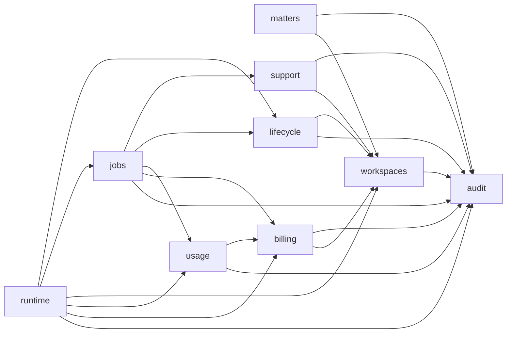

# Core domains

`@causedeck/core` is one package split into domains (#293): one folder each under
`packages/core/src/`. A domain exposes a public `index.ts`, and other domains import it only
through that file and only along the edges in the dependency map below. ESLint enforces this with
`causedeck/core-domain-boundaries` (`packages/config/eslint/rules/core-domain-boundaries.js`), and
`packages/core/src/domains.test.ts` checks the layout. When core splits into separate packages is
decided in [ADR 0012](../adr/0012-core-package-split-threshold.md).

```sh
pnpm --filter @causedeck/config exec vitest run test/core-domain-boundaries.test.ts test/eslint-boundaries.test.ts
pnpm --filter @causedeck/core exec vitest run src/domains.test.ts
```

## Domains

| Folder | Public entry point | What |
|---|---|---|
| `audit` | `@causedeck/core/audit` | audit writer, chain verification, feed query and export ([audit.md](audit.md)) |
| `workspaces` | `@causedeck/core/workspaces` | workspaces, members, invitations, offboarding ([workspaces.md](workspaces.md)) |
| `matters` | `@causedeck/core/matters` | matter restrictions |
| `billing` | `@causedeck/core/billing` | entitlements, subscriptions, invoices ([billing.md](billing.md)) |
| `usage` | `@causedeck/core/usage` | metering, AI budget, fair use ([usage-metering.md](usage-metering.md)) |
| `support` | `@causedeck/core/support` | consented, time-boxed staff support sessions and the read-only support context ([audit.md](audit.md)) |
| `jobs` | `@causedeck/core/jobs` | job definitions and handlers ([jobs.md](jobs.md)) |
| `runtime` | `@causedeck/core/runtime` | the app's runtime database seam: services that bind the app-role handle and delegate to the other domains. apps/web, apps/api and apps/worker use it (#299): the `db` handle, `closeAppDb`, `inWorkspaceOn` for an injected handle and the api idempotency store |
| `shared` | none | helpers no domain owns |

`packages/core/src/index.ts` re-exports only domain entry points (`./<domain>/index.ts`). It does
not re-export `billing` or `shared`: the cross-tenant services suite
(`packages/core/src/__tests__/cross-tenant/services.test.ts`) calls every root export with another
workspace's ids, and billing is imported from `@causedeck/core/billing` by the code that needs it.

## The entry point rule

Another domain imports `../<domain>/index.ts` (also accepted: `../<domain>`, `../<domain>/index`,
`../<domain>/index.js`), never `../<domain>/<internal>.ts`. This covers `import`, `import type`,
`export … from` and dynamic `import()`. Imports inside a domain, of `shared/`, and of other packages
by name are not checked by this rule.

## shared/

`packages/core/src/shared/` holds code several domains need and no domain owns: the
`WorkspaceError` helpers (`errors.ts`), the live-workspace and active-member SQL predicates
(`membership.ts`), the `AuditEvent` / `AuditSink` interfaces (`audit-sink.ts`) and
`DEFAULT_FAIRNESS_CONCURRENCY` (`fairness.ts`). Anything may import `shared/`; `shared/` imports no
domain. It is not a package export: `workspaces` and `jobs` re-export the public symbols, so
`WorkspaceError` is still one class wherever it is imported from. Move a helper here when it would
otherwise create an undeclared edge or a cycle.

## Dependency map

The single source of truth is `CORE_DOMAIN_DEPENDENCIES` in
`packages/config/eslint/core-domains.js`. It must stay acyclic (`findCoreDomainCycle`).



| Domain | May import |
|---|---|
| `shared` | nothing |
| `audit` | nothing (only `shared/`) |
| `workspaces` | `audit` |
| `matters` | `workspaces`, `audit` |
| `billing` | `workspaces`, `audit` |
| `usage` | `audit`, `billing` |
| `lifecycle` | `audit`, `workspaces` |
| `support` | `workspaces`, `audit` |
| `jobs` | `audit`, `billing`, `usage`, `lifecycle`, `support` |
| `runtime` | `audit`, `billing`, `usage`, `workspaces`, `jobs`, `lifecycle` |

The issue's example had `billing → usage`; the code needs the reverse: usage limits, budget,
fair-use caps and job fairness read billing entitlements.

## Adding a domain

1. Create `packages/core/src/<domain>/` with an `index.ts`.
2. Add the domain and its allowed imports to `CORE_DOMAIN_DEPENDENCIES`.
3. Add `"./<domain>": "./src/<domain>/index.ts"` to `packages/core/package.json` exports, and to
   `src/index.ts` only if every export is safe for the cross-tenant services suite.
4. Add a row to the tables above.

A folder missing from the map fails lint (`unknownDomain`) and `domains.test.ts`.

## Tests

Tests (`*.test.ts` and anything under `__tests__/`) may import any domain, even one the map does
not list for their own domain, but only through its `index.ts`. Shared test fixtures live in
`packages/core/src/__tests__/` (for example `fixtures.ts`); root files (`src/index.ts`,
`src/*.test.ts`, `src/__tests__/**`) also import domains only through their `index.ts`.
