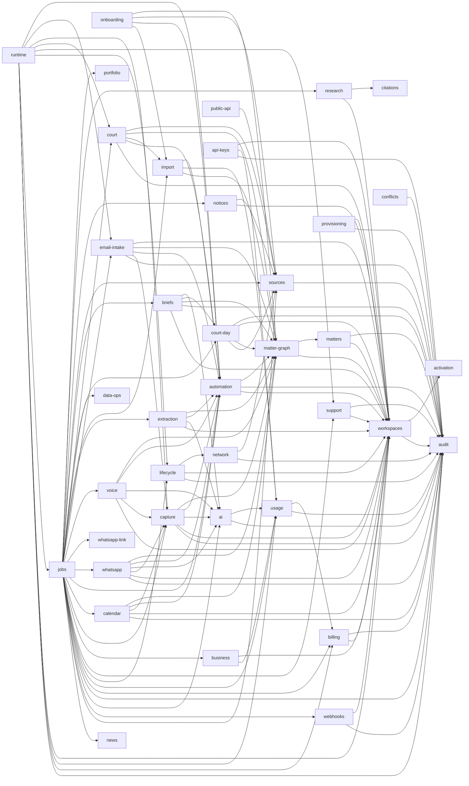

# Core domains

`@causedeck/core` is one package split into domains (#293): one folder each under
`packages/core/src/`. A domain exposes a public `index.ts`, and other domains import it only
through that file and only along the edges in the dependency map below. ESLint enforces this with
`causedeck/core-domain-boundaries` (`packages/config/eslint/rules/core-domain-boundaries.js`), and
`packages/core/src/domains.test.ts` checks the layout. When core splits into separate packages is
decided in [ADR 0012](../adr/0012-core-package-split-threshold.md).

```sh
pnpm --filter @causedeck/config exec vitest run test/core-domain-boundaries.test.ts test/eslint-boundaries.test.ts
pnpm --filter @causedeck/core exec vitest run src/domains.test.ts
```

## Domains

| Folder         | Public entry point             | What                                                                                                                                                                                                                                                                                                                                                                                                                                                                                                                                                                                                                                                                                                                                                                                                                                                                                                                                                                                                                                                                                                                                                                                                                                                                                                                                                                                                                                                                                                                                                                                                                                           |
| -------------- | ------------------------------ | ---------------------------------------------------------------------------------------------------------------------------------------------------------------------------------------------------------------------------------------------------------------------------------------------------------------------------------------------------------------------------------------------------------------------------------------------------------------------------------------------------------------------------------------------------------------------------------------------------------------------------------------------------------------------------------------------------------------------------------------------------------------------------------------------------------------------------------------------------------------------------------------------------------------------------------------------------------------------------------------------------------------------------------------------------------------------------------------------------------------------------------------------------------------------------------------------------------------------------------------------------------------------------------------------------------------------------------------------------------------------------------------------------------------------------------------------------------------------------------------------------------------------------------------------------------------------------------------------------------------------------------------------- |
| `audit`        | `@causedeck/core/audit`        | audit writer, chain verification, feed query and export ([audit.md](audit.md))                                                                                                                                                                                                                                                                                                                                                                                                                                                                                                                                                                                                                                                                                                                                                                                                                                                                                                                                                                                                                                                                                                                                                                                                                                                                                                                                                                                                                                                                                                                                                                 |
| `activation`   | `@causedeck/core/activation`   | product activation events and the funnel and time-to-value reads behind the admin Growth page (#509); not re-exported from the root |
| `workspaces`   | `@causedeck/core/workspaces`   | workspaces, members, invitations, offboarding ([workspaces.md](workspaces.md))                                                                                                                                                                                                                                                                                                                                                                                                                                                                                                                                                                                                                                                                                                                                                                                                                                                                                                                                                                                                                                                                                                                                                                                                                                                                                                                                                                                                                                                                                                                                                                 |
| `matters`      | `@causedeck/core/matters`      | matter restrictions                                                                                                                                                                                                                                                                                                                                                                                                                                                                                                                                                                                                                                                                                                                                                                                                                                                                                                                                                                                                                                                                                                                                                                                                                                                                                                                                                                                                                                                                                                                                                                                                                            |
| `court`        | `@causedeck/core/court`        | forum catalogue reads, custom workspace forums and official deep links (#34, [ADR 0014](../adr/0014-forum-catalogue-and-deep-links.md)), the tenant-free adapter parse-health summary (#372), and the courts read models `getCourtsIndex`, `getForumDetail`, `getAdapterStatus` and `listHallsSeen` (#397; access-mode rows with counsel notes via `@causedeck/flags/access-mode`), the roster services (#385, #387), and bench-change detection and alerts `detectBenchChanges`, `listAlerts`, `dismissAlert` with the `CourtEvents` port (`bench.changed`) and `notify()` delivery (#389), and the rosters page read model `getRostersPage` (#434), and the KHC cause-list watches `addCauseListWatch`, `listCauseListWatches`, `removeCauseListWatch` and `pollCauseList` (#482: one fetch per list publication shared by every workspace, matched rows staged as L2 proposals), and the bench-notice alerts `classifyBenchNotice` (rules over a notice title: leave, special bench or roster reassignment, with the halls and case types it names; no AI, no judges), `listBenchNoticeAlerts` (read-time map from matched notices to the listings and matters they affect) and `notifyBenchNoticeAlerts` (#496: one `bench_change` alert per member who may read an affected matter, per notice, counts only)                                                                                                                                                                                                                                                                                                                              |
| `facts`        | `@causedeck/core/facts`        | cross-checked facts (#499, D-026): `assessAgreement` compares what each source says about one fact and returns the sources, an agreement status (`agree`, `conflict`, `single`) and a confidence score (agreeing sources raise it, a rival source discounts it); `getNextDateAgreement` and `getStageAgreement` read it for a proceeding's next date and stage from the canonical listing and its open proposals. It never resolves a conflict: a person does, through the matter-graph next-date services                                                                                                                                                                                                                                                                                                                                                                                                                                                                                                                                                                                                                                                                                                                                                                                                                                                                                                                                                                                                                                                                                                                                     |
| `matter-graph` | `@causedeck/core/matter-graph` | matter-graph services (#362): matters, proceedings, documents, the duplicate finder, the proceeding state machine (#363, ADR 0016), the canonical next date (#364: propose, confirm, read; the only writer of `listing.list_date` and `canonical`), merges and splits with `UndoPayload` (#365) and their read-only previews (#392), the cross-proceeding matter timeline (#366, read-only), the matters read models (#386) and the document preview read model `getDocumentPreview` (#393: one page's text and the version chain, for `DocumentPreviewSheet`), and the `GraphEvents` port they emit through                                                                                                                                                                                                                                                                                                                                                                                                                                                                                                                                                                                                                                                                                                                                                                                                                                                                                                                                                                                                                                   |
| `automation`   | `@causedeck/core/automation`   | the automation engine (#47, [ADR 0023](../adr/0023-automation-ladder-and-undo.md)): the L1-L4 ladder, the approval matrix as data and `decideLevel`, proposals (`submitProposals`, `acceptProposal`, `editAndAccept`, `dismissProposal`, `applyAutomatically`, `expireProposals`), the kind handlers that write through the matter-graph services, the 7-day cascading undo (`undoActivity`, `undoCapture`, `reassignCapture`), the ask-first dial, threshold learning, the activity feed read model (#49: `listActivities` keyset-paged with filters and search, `getActivityDetail`, `countByDay`, and `countDigestActivities` for the end-of-day digest; a row about a matter the member may not read is returned redacted, a clerk gets only `CLERK_ACTIVITY_KINDS`) and the activity export (owners the workspace, everyone else their own activity, audited as `audit.exported`). It has no send, file, pay or advise path (`scripts/check-no-l5.ts`)                                                                                                                                                                                                                                                                                                                                                                                                                                                                                                                                                                                                                                                                                    |
| `deadlines`    | `@causedeck/core/deadlines`    | the deadline engine (#494, D-048): `computeDueDate` (a period in days, weeks or months from an anchor date, rolled to the next working day when the court is closed on the last day; returns the date and the rule as a sentence, e.g. "4 weeks from 22 Oct; court closed 19 Nov, so 20 Nov"), `loadCourtCalendar` (a forum's calendar: Sunday weekly off, holidays from the `holiday` notices matched to the workspace, vacations from the static per-forum `FORUM_VACATIONS` table because a notice carries a single date), and `deadlineForDirection` / `applyDeadlineRules`, which `extraction` uses to re-derive dated "within" directions on the proceeding's forum calendar (the rule becomes the obligation's `basis`; an "after" listing date is left as extracted; Limitation Act rules are separate, #84)                                                                                                                                                                                                                                                                                                                                                                                                                                                                                                                                                                                                                                                                                                                                                                                                                           |
| `case-watch`   | `@causedeck/core/case-watch`   | case-status watches (#591, D-048, #483 part 3): `addCaseWatch`, `listCaseWatches`, `removeCaseWatch` (an advocate's own watches on proceedings they can read), `runCaseStatusLookup` (the server path: only the advocate's own watch, always through `@causedeck/fetch` with `delegatedFor`, so a bulk or unscoped lookup cannot be made; parsed with the `@causedeck/adapters` status parsers) and `recordDeviceSnapshot` (a device-read status), snapshots with provenance (tier used, cost, device or server; an unchanged page writes no second row) and `diffStatus`, which stages a new next hearing date as an L2 `case_status_change` proposal confirmed through the matter-graph next-date services; `pollCaseWatches` (#592, the body of `system.status.poll`: due watches through `app_case_watch_due`, each run as its own advocate with per-advocate and per-source caps, a killed source skipped) and `notifyStatusChanges` (new date, new order and stage change alerts to the advocate, never on the first snapshot or a sensitive matter) and `pollOrders` (#494, the body of `system.orders.poll`: the order links of a watch's latest snapshot not yet captured are fetched as delegated lookups with the same caps and kill switch and stored as captures, so `extraction` stages their directions as L2 proposals; a sensitive matter is never auto-captured)                                                                                                                                                                                                                                                             |
| `portfolio`    | `@causedeck/core/portfolio`    | institution portfolios (#663, #498 part 3, D-048 B2B): `importPortfolioCases` (owner-only CSV of CNRs or case numbers, at most 1,000 rows: stores `portfolio_case` rows and creates delegated `case_watch` rows for cases whose CNR is a workspace proceeding, round-robin over the portfolio's panel advocates who can read the matter, capped per advocate, at cleared status sources only, with the first polls staggered over one cadence; it never fetches, so the poll's own caps are the rate budget; a bare CNR stays an unwatched case), `listPortfolioCases` and `portfolioSummary` (dashboard: next dates, stage, adverse orders) and `exportPortfolioCsv` (formula-safe); `scanPortfolioAlerts` (#665: notifies the workspace's active members of a new adverse order or a missed next date, deduped per case; run daily by `system.portfolio-alert.scan`); `parsePortfolioCsv` is the pure reader                                                                                                                                                                                                                                                                                                                                                                                                                                                                                                                                                                                                                                                                                                                                                                                                                                                                                                                   |
| `notices`      | `@causedeck/core/notices`      | the official notices feed (#586, D-048, part 3 of #480): `pollNotices` (fetches each cleared `notice` source once through the governed fetch layer via a structural `NoticeFetcher` port, parses it with the source's parser, stores new notices once with provenance, never fetches an uncleared source) and `matchNotices` (matches notices to the workspaces and matters with a proceeding before the forums they name, through the owner-defined `app_notice_match_targets`), `notifyNoticeMatches` (#587: one `notices` alert per active member who may read matters, per notice, deduplicated by notification `dedupeKey`) and `listHolidayListings` (#587: the workspace's listings that fall on the `effective_on` date of a matched `holiday` notice for their forum), run hourly by `system.notices.poll`; `pollNotices` takes an optional `onMatched` hook (#496) that the job wires to `notifyBenchNoticeAlerts`, so `notices` does not import `court`                                                                                                                                                                                                                                                                                                                                                                                                                                                                                                                                                                                                                                                                             |
| `api-keys`     | `@causedeck/core/api-keys`     | public API keys (#624, #487 part 1): `createApiKey` (the token is shown once, only its SHA-256 is stored), `listApiKeys`, `revokeApiKey` (both audited), `authenticateApiKey` (reads one key by hash through the owner-defined `app_api_key_by_hash`), scopes, and `consumeApiCall` (per-key monthly quota, one billed `api.calls` usage unit per request)                                                                                                                                                                                                                                                                                                                                                                                                                                                                                                                                                                                                                                                                                                                                                                                                                                                                                                                                                                                                                                                                                                                                                                                                                                                                                     |
| `provisioning` | `@causedeck/core/provisioning` | bulk seat provisioning (#684, part of #508): `provisionFromCsv` (CSV rows with a dry run; invites new addresses, skips active members, one audit event per run), SCIM tokens (`createScimToken`, `authenticateScimToken` through the owner-defined `app_scim_token_by_hash`) and the SCIM v2 Users service behind `apps/web/app/api/scim` |
| `webhooks`     | `@causedeck/core/webhooks`     | change webhooks (#626, #487 part 3): `createWebhookEndpoint` (the HMAC secret is returned once, audited), `listWebhookEndpoints`, `deleteWebhookEndpoint` (all need `workspace.manage`), `signWebhook` / `verifyWebhookSignature` (HMAC-SHA256 over `timestamp.body`) and `emitWebhookEvent` (one pending delivery per matching active endpoint of the workspace; a content-free payload of ids, CNR, kinds of change, provenance and source licensor; none for a sensitive matter). The `webhook.deliver` job sends through `@causedeck/fetch` `deliverWebhook`; `system.webhook.sweep` re-enqueues due deliveries                                                                                                                                                                                                                                                                                                                                                                                                                                                                                                                                                                                                                                                                                                                                                                                                                                                                                                                                                                                                                            |
| `conflicts`    | `@causedeck/core/conflicts`    | conflict-of-interest checks (#500, D-048, counsel-gated by #486): `checkConflicts` matches the names on a new matter against the chamber's own matters and parties, in the caller's workspace transaction only, transliteration-aware for Tamil and Kannada and tolerant of organisation abbreviations; every check is audited as `conflict.checked` (counts, never names) and nothing blocks the advocate                                                                                                                                                                                                                                                                                                                                                                                                                                                                                                                                                                                                                                                                                                                                                                                                                                                                                                                                                                                                                                                                                                                                                                                                                                     |
| `billing`      | `@causedeck/core/billing`      | entitlements, subscriptions, invoices ([billing.md](billing.md))                                                                                                                                                                                                                                                                                                                                                                                                                                                                                                                                                                                                                                                                                                                                                                                                                                                                                                                                                                                                                                                                                                                                                                                                                                                                                                                                                                                                                                                                                                                                                                               |
| `usage`        | `@causedeck/core/usage`        | metering, AI budget, fair use ([usage-metering.md](usage-metering.md))                                                                                                                                                                                                                                                                                                                                                                                                                                                                                                                                                                                                                                                                                                                                                                                                                                                                                                                                                                                                                                                                                                                                                                                                                                                                                                                                                                                                                                                                                                                                                                         |
| `ai`           | `@causedeck/core/ai`           | the AI gateway wiring (#44, [ADR 0022](../adr/0022-ai-gateway-implementation.md)): the ports `@causedeck/ai` declares, implemented on usage budgets, `workspace_settings.india_only_ai`, `matter.sensitive`, the `ai_call` writer and the 24 h `ai_call_result` store                                                                                                                                                                                                                                                                                                                                                                                                                                                                                                                                                                                                                                                                                                                                                                                                                                                                                                                                                                                                                                                                                                                                                                                                                                                                                                                                                                          |
| `sources`      | `@causedeck/core/sources`      | the source registry (D-048): `policyFor` / `isCleared` fail closed, and audited staff changes to every external data source                                                                                                                                                                                                                                                                                                                                                                                                                                                                                                                                                                                                                                                                                                                                                                                                                                                                                                                                                                                                                                                                                                                                                                                                                                                                                                                                                                                                                                                                                                                    |
| `news`         | `@causedeck/core/news`         | the legal news digest (#481, D-048): `upsertNewsItems` (global `news_item`, idempotent on source and URL, feed-provided fields only), the member's `news_pref` (`getNewsPref`, `setNewsPref`), `listNewsForMember` and `selectNewsDigestItems` (tagged items first, then recency, with source attribution and the link to the original)                                                                                                                                                                                                                                                                                                                                                                                                                                                                                                                                                                                                                                                                                                                                                                                                                                                                                                                                                                                                                                                                                                                                                                                                                                                                                                        |
| `citations`    | `@causedeck/core/citations`    | citation verification (#484, D-004): `verifyCitation` resolves a neutral citation (Madras HC, Karnataka HC, Supreme Court) to a stored judgment in the global raw corpus with page anchors, or marks it UNVERIFIED                                                                                                                                                                                                                                                                                                                                                                                                                                                                                                                                                                                                                                                                                                                                                                                                                                                                                                                                                                                                                                                                                                                                                                                                                                                                                                                                                                                                                             |
| `court-day`    | `@causedeck/core/court-day`    | court-day display-board tracking (#493, D-048): `pollBoards` (one governed fetch per High Court board per run, only in court hours and only for halls where a workspace has an item listed today; content-free `board_observation` rows; `court.board` alerts through `notify()` at 5 away, 2 away, now, risen and passed over, deduped per listing and threshold), the `getLiveHalls` read model and the call-time estimate `estimateCallWindow` / `backtestEta` (a range with a confidence level, never a promise); the court day (#58, ADR 0037): `getCourtDay` (a day's listings grouped complex, hall, list type and item, scoped `mine` or `workspace`, with `expectedNotListed`), `detectClashes` (same member, same date, different hall or complex; a fact, never a predicted overlap), `snapshotList` / `diffLists` (immutable list snapshots and their diff), `setCurrentItem` / `clearCurrentItem` (the lawyer's manual hall marker, audited) and `proposeCourtDayNextDate` / `listConflictCards` over the matter graph                                                                                                                                                                                                                                                                                                                                                                                                                                                                                                                                                                                                                                                                                                                                                                                                                                                                                                                                                                                                                                                                                                                           |
| `briefs` | `@causedeck/core/briefs` | the derived listing brief (#60, ADR 0038): `assembleBrief` (stage, last order in 2-3 anchored lines, open obligations, carry list, M3 synopsis, last hearing, M4 court notes and up to 5 matter-scoped full-text passages; every line carries its provenance or is dropped; strategy and court notes left out server-side for a clerk; no AI or context retrieval on a sensitive matter), `computeReadiness` (pure), the lawyer-authored `brief_state` (`markPrepared`, `unmarkPrepared`, `setCarryItem`, `setBriefNote`; a material change clears the mark and emits `brief.stale`), `refreshBrief` and the `refreshBriefTargets` sweep behind `brief.refresh` and `system.brief.refresh-sweep`; the memory port defaults to empty until #74 |
| `research`     | `@causedeck/core/research`     | judgment alerts (#497, D-048): per-matter issue tags (`listTags`, `addTag`, `proposeTags`, `confirmTag`, `dismissTag`; only confirmed tags drive alerts), `scanJudgments` (matches new corpus judgments to confirmed tags by statute and section, writes `judgment_alert` rows and notifies advocates who may read the matter; sensitive matters never alert) and `listRelevantJudgments` (keeps only alerts whose judgment `verifyCitation` resolves, D-004)                                                                                                                                                                                                                                                                                                                                                                                                                                                                                                                                                                                                                                                                                                                                                                                                                                                                                                                                                                                                                                                                                                                                                                                  |
| `network`      | `@causedeck/core/network`      | the court document network (#485, D-048 tier 3): opt-in contribution of public court documents (cause lists, published orders) stored once globally, `findContributed` reads, and withdrawal on workspace erase                                                                                                                                                                                                                                                                                                                                                                                                                                                                                                                                                                                                                                                                                                                                                                                                                                                                                                                                                                                                                                                                                                                                                                                                                                                                                                                                                                                                                                |
| `public-api`   | `@causedeck/core/public-api`   | the public developer API reads (#625, D-048, D-050): `getPublicCase`, `listPublicCauseLists`, `listPublicOrders` and `listPublicNotices` return records with provenance and a derived `sourceLicense`; a record is served only when its source is cleared and, for shared (global) data, `non-personal` (`exposableThroughApi`); personal data only for the caller's own non-sensitive matters under the workspace scope; no contributor, rating, ranking or prediction fields                                                                                                                                                                                                                                                                                                                                                                                                                                                                                                                                                                                                                                                                                                                                                                                                                                                                                                                                                                                                                                                                                                                                                                 |
| `support`      | `@causedeck/core/support`      | consented, time-boxed staff support sessions and the read-only support context ([audit.md](audit.md))                                                                                                                                                                                                                                                                                                                                                                                                                                                                                                                                                                                                                                                                                                                                                                                                                                                                                                                                                                                                                                                                                                                                                                                                                                                                                                                                                                                                                                                                                                                                          |
| `business`     | `@causedeck/core/business`     | the internal business dashboard (#519, D-049): `staffBusinessSnapshot` / `readBusinessSnapshot` (aggregates from the owner-defined `app_business_snapshot` functions), the pure MRR, ARR, churn, conversion, cost-per-user and margin maths, the cost-per-user threshold and the founders' digest and alert emails                                                                                                                                                                                                                                                                                                                                                                                                                                                                                                                                                                                                                                                                                                                                                                                                                                                                                                                                                                                                                                                                                                                                                                                                                                                                                                                             |
| `capture`      | `@causedeck/core/capture`      | the capture inbox (#43, [ADR 0021](../adr/0021-capture-inbox-and-upload-pipeline.md)): `createCapture` / `completeUpload` / `createManualCapture`, per-channel opt-in, discard and pin, raw-object retention, `deleteRecording` (a voice recording and its transcript, #542), the diary-photo step of `capture.process` for channel `camera` (#52, [ADR 0030](../adr/0030-diary-photo-capture-and-image-anchors.md)), and the bodies of `capture.scan`, `capture.process` and `capture.retention`; jobs arrive as the `CaptureJobs` port. Not re-exported from the package root                                                                                                                                                                                                                                                                                                                                                                                                                                                                                                                                                                                                                                                                                                                                                                                                                                                                                                                                                                                                                                                                |
| `calendar`     | `@causedeck/core/calendar`     | calendar interop (#53, [ADR 0024](../adr/0024-ics-import-and-private-feed.md)): the private ICS feed (`createFeed` / `rotateFeed` / `revokeFeed`, the unauthenticated `serveFeed`) and the ICS import (`runIcsImport`, the `capture.process` body for channel `ics`, and its review). Pure parsing and rendering is `@causedeck/capture` `ics/`. Not re-exported from the package root                                                                                                                                                                                                                                                                                                                                                                                                                                                                                                                                                                                                                                                                                                                                                                                                                                                                                                                                                                                                                                                                                                                                                                                                                                                         |
| `email-intake` | `@causedeck/core/email-intake` | email forward-in intake (#54): the per-user intake address (`createAddress`, `rotateAddress`, `revokeAddress`, `getActiveAddress`, `resolveAddress` with no oracle), the sender allow-list (`addAllowlistEntry`, `removeAllowlistEntry`, `listAllowlist`) and `enableEmailChannel`, and the inbound side (#530): `receiveInboundEmail` (record once per message id, enqueue `email.intake`), `runEmailIntake` (the job body: sender trust, parser registry, captures, proposals) and `sweepExpiredRawMime`. Not re-exported from the package root                                                                                                                                                                                                                                                                                                                                                                                                                                                                                                                                                                                                                                                                                                                                                                                                                                                                                                                                                                                                                                                                                              |
| `extraction`   | `@causedeck/core/extraction`   | anchored order extraction (#46, [ADR 0028](../adr/0028-anchored-extraction.md)): `runOrderExtraction`, the body of the `extraction.extract-order` job. It reads a processed order or judgment, runs the deterministic pre-parse and (only where AI is allowed) the `extract_order` task, stores the validated extraction and its rejections (superseding, never deleting), stages proposals through automation and routes a capture that needs a person to "Needs you". Pure steps are `@causedeck/intelligence` `extract/`. Not re-exported from the package root                                                                                                                                                                                                                                                                                                                                                                                                                                                                                                                                                                                                                                                                                                                                                                                                                                                                                                                                                                                                                                                                             |
| `whatsapp`     | `@causedeck/core/whatsapp`     | the WhatsApp chat import (#526, PRD CA-6): `receiveWhatsAppImport` (the `whatsapp_export` intake: `validateSelection` re-applied server-side, selected messages only, audio never transcribed) and `runWhatsAppImport` (the `whatsapp.import` job body: the `structure_chat` task on internal chats only, proposals anchored to the source message, the 30-day raw-text clock). Parsing, rules and the pure structuring are `@causedeck/capture` `whatsapp/`. Not re-exported from the package root                                                                                                                                                                                                                                                                                                                                                                                                                                                                                                                                                                                                                                                                                                                                                                                                                                                                                                                                                                                                                                                                                                                                            |
| `whatsapp-link` | `@causedeck/core/whatsapp-link` | the WhatsApp number link (#678, #502 part 1, D-029): `requestWhatsAppOtp` (opt-in required; stores a hash of a six-digit code with a 10-minute expiry, a 60-second resend cooldown and a 5-attempt cap, then sends it through the injected sender), `verifyWhatsAppOtp` (creates the member's link), `setWhatsAppCategories`, `getWhatsAppLink` (number masked), `unlinkWhatsApp` (deletes the link and any challenge, which stops all messages) and `getWhatsAppSendTarget`, the only way to get a destination: the owner's own verified number, null otherwise. Inbound forward-in (#680, #502 part 3): `receiveInboundWhatsApp` (the webhook side: sender resolved without an oracle, allow-list, `whatsapp` channel gate, one row per provider message id) and `runWhatsAppIntake` (the `whatsapp.intake` job body: download, sniff, dedupe, store as a `whatsapp` capture) |
| `onboarding`   | `@causedeck/core/onboarding`   | zero-entry onboarding discovery (#501, D-048): `discoverAdvocateCases` searches the courts' advocate searches through the governed fetch layer (delegated, 30 to 90 days back plus upcoming), keeps only rows that carry the advocate, and stages them as proposals on an import batch for the confirm grid; a name-only identity returns sample matters to confirm and a same-name row with another enrolment number is left out; uncleared sources are skipped; nothing is applied; not re-exported from the root |
| `import`       | `@causedeck/core/import`       | the bootstrap import plan engine (#57 part 2, #548): `getAdvocateIdentifiers`, the matched-only `filterMatchedRows` (a row that does not match the advocate is counted and never stored or logged), `clusterProceedings` (parent/child, connected batches, appeal links, same parties; deterministic, with confidence and reason), the `ImportPlan` types and `buildImportPlan` (reads the proposals of a batch's captures, applies the IST next-date/history rules, stores the plan on `import_plan` and the batch counters). `applyImportPlan` (#549: chunked writes through matter-graph with `import` provenance, idempotent by batch and plan hash, duplicates offered as a merge, sensitive matters excluded unless included, one L3 activity per matter under one cascade group), `undoImportBatch` (reverses the group within 7 days) and the free-plan OCR cap (`splitByOcrAllowance`: past the cap files are attached unread; `batchCostPaise`). The batch (#57 part 4, #550): `createImportBatch`, `addImportFiles` (uploaded `bulk_import` captures), `getImportProgress`, `processImportFile` (a cause list is read by the dedicated court adapter that detects it and only rows matching the advocate are staged as proposals; a list no dedicated adapter reads is kept as an attachment with a needs-a-dedicated-adapter note), `finishImportBatch` (builds the plan once no file is waiting) and the per-member `advocate_profile` identifiers (`getAdvocateProfile`, `saveAdvocateProfile`, saved only when confirmed); the `import.batch` and `import.file` jobs in `jobs` wrap them. Not re-exported from the package root |
| `migration`    | `@causedeck/core/migration`    | the migration concierge (#685, part of #508): bulk matter import for onboarding a firm. `parseMigrationCsv` (pure: column mapping, at most 5,000 rows, issue codes per row, never row content), `startMigrationRun` (a `dry_run` writes only the run and its row states and reports mapping issues; an `import` run stores each chunk of 250 rows as a ready import batch), `runMigrationChunk` / `resumeMigrationRun` (apply the next chunk through `applyImportPlan`, record row states, resume from the stored chunk without the file), `rollbackMigrationRun` (`undoImportBatch` per chunk), `getMigrationProgress`, `getMigrationReport`, `listMigrationRuns`. Owner-only. Not re-exported from the package root |
| `voice`        | `@causedeck/core/voice`        | voice capture (#542, [ADR 0029](../adr/0029-voice-capture-and-spoken-date-validation.md)): `runVoiceProcess`, the body of the `voice.process` job (queued by `capture.process` for channel `voice`). It never reads audio of an `ai_blocked` capture, sends unreadable audio to "Needs you" with no drafts, transcribes (`transcribe`), structures (`structure_hearing`), stores the transcript as a note document with `transcript` anchors and stages proposals. Pure steps are `@causedeck/intelligence` `transcribe/` and `structure/`. Not re-exported from the package root                                                                                                                                                                                                                                                                                                                                                                                                                                                                                                                                                                                                                                                                                                                                                                                                                                                                                                                                                                                                                                                              |
| `review` | `@causedeck/core/review` | the Data Ops review and correction queue (#518, D-049): `review_item` (low-confidence parses, conflicts, user reports) with assignee, SLA by kind, a fix and send-to-workbench; `reportRecordError` (consent and a watched case required); `resolveReviewItem` fans the fix out through the staff-only `app_review_propagate` as `review_correction` rows ("corrected by CauseDeck review"). Every staff read of an item is audited (`staff.read`, ids only). Imports `audit`; not re-exported from the package root |
| `data-ops` | `@causedeck/core/data-ops` | data-operations alerting (#515, [ADR 0035](../adr/0035-data-ops-alerting.md)): the pure SLO detectors, the alert ledger (open once, refresh, auto-resolve), Slack and email routing with the on-call rotation, a runbook link per alert type, the block-backoff and parser-quarantine responses and `recordParseRun`. Imports `review` to open a review item from a breached parse-yield or conflict-rate detection; the `system.data-ops.evaluate` job in `jobs` wraps it. Not re-exported from the package root |
| `jobs`         | `@causedeck/core/jobs`         | job definitions and handlers ([jobs.md](jobs.md))                                                                                                                                                                                                                                                                                                                                                                                                                                                                                                                                                                                                                                                                                                                                                                                                                                                                                                                                                                                                                                                                                                                                                                                                                                                                                                                                                                                                                                                                                                                                                                                              |
| `runtime`      | `@causedeck/core/runtime`      | the app's runtime database seam: services that bind the app-role handle and delegate to the other domains. apps/web, apps/api and apps/worker use it (#299): the `db` handle, `closeAppDb`, `inWorkspaceOn` for an injected handle and the api idempotency store; the roster wrappers `previewRosterImportFor` and `confirmRosterImportFor` (#434)                                                                                                                                                                                                                                                                                                                                                                                                                                                                                                                                                                                                                                                                                                                                                                                                                                                                                                                                                                                                                                                                                                                                                                                                                                                                                             |
| `shared`       | none                           | helpers no domain owns                                                                                                                                                                                                                                                                                                                                                                                                                                                                                                                                                                                                                                                                                                                                                                                                                                                                                                                                                                                                                                                                                                                                                                                                                                                                                                                                                                                                                                                                                                                                                                                                                         |

`packages/core/src/index.ts` re-exports only domain entry points (`./<domain>/index.ts`). It does
not re-export `billing` or `shared`: the cross-tenant services suite
(`packages/core/src/__tests__/cross-tenant/services.test.ts`) calls every root export with another
workspace's ids, and billing is imported from `@causedeck/core/billing` by the code that needs it.

## The entry point rule

Another domain imports `../<domain>/index.ts` (also accepted: `../<domain>`, `../<domain>/index`,
`../<domain>/index.js`), never `../<domain>/<internal>.ts`. This covers `import`, `import type`,
`export … from` and dynamic `import()`. Imports inside a domain, of `shared/`, and of other packages
by name are not checked by this rule.

## shared/

`packages/core/src/shared/` holds code several domains need and no domain owns: the
`WorkspaceError` helpers (`errors.ts`), the live-workspace and active-member SQL predicates
(`membership.ts`), the `AuditEvent` / `AuditSink` interfaces (`audit-sink.ts`) and
`DEFAULT_FAIRNESS_CONCURRENCY` (`fairness.ts`). Anything may import `shared/`; `shared/` imports no
domain. It is not a package export: `workspaces` and `jobs` re-export the public symbols, so
`WorkspaceError` is still one class wherever it is imported from. Move a helper here when it would
otherwise create an undeclared edge or a cycle.

## Dependency map

The single source of truth is `CORE_DOMAIN_DEPENDENCIES` in
`packages/config/eslint/core-domains.js`. It must stay acyclic (`findCoreDomainCycle`).



| Domain         | May import                                                                                                                                                                                                                                                                    |
| -------------- | ----------------------------------------------------------------------------------------------------------------------------------------------------------------------------------------------------------------------------------------------------------------------------- |
| `shared`       | nothing                                                                                                                                                                                                                                                                       |
| `audit`        | nothing (only `shared/`)                                                                                                                                                                                                                                                      |
| `activation`   | nothing |
| `workspaces`   | `audit`, `activation`                                                                                                                                                                                                                                                                       |
| `matters`      | `workspaces`, `audit`                                                                                                                                                                                                                                                         |
| `court`        | `workspaces`, `automation`, `import`, `matter-graph`, `sources`                                                                                                                                                                                                               |
| `court-day`    | `sources`, `matter-graph`, `workspaces`, `audit`                                                                                                                                                                                                                                                                     |
| `briefs` | `workspaces`, `audit`, `matter-graph`, `court-day`, `ai` |
| `case-watch`   | `workspaces`, `automation`, `matter-graph`, `sources`, `audit`, `capture`                                                                                                                                                                                                     |
| `portfolio`    | `workspaces`, `matter-graph`, `case-watch`, `sources`                                                                                                                                                                                                                         |
| `whatsapp-link` | `workspaces`, `audit`, `capture` |
| `deadlines`    | none (reads the notice tables directly; the period arithmetic is `@causedeck/intelligence`)                                                                                                                                                                                   |
| `notices`      | `workspaces`, `sources`                                                                                                                                                                                                                                                       |
| `api-keys`     | `audit`, `usage`, `workspaces`                                                                                                                                                                                                                                                |
| `provisioning` | `audit`, `workspaces` |
| `webhooks`     | `audit`, `workspaces`                                                                                                                                                                                                                                                         |
| `conflicts`    | `audit`                                                                                                                                                                                                                                                                       |
| `facts`        | none                                                                                                                                                                                                                                                                          |
| `matter-graph` | `workspaces`, `matters`                                                                                                                                                                                                                                                       |
| `automation`   | `workspaces`, `audit`, `matter-graph`                                                                                                                                                                                                                                         |
| `billing`      | `workspaces`, `audit`                                                                                                                                                                                                                                                         |
| `usage`        | `audit`, `billing`                                                                                                                                                                                                                                                            |
| `ai`           | `audit`, `usage`                                                                                                                                                                                                                                                              |
| `lifecycle`    | `audit`, `workspaces`, `network`                                                                                                                                                                                                                                              |
| `sources`      | `audit`                                                                                                                                                                                                                                                                       |
| `news`         | nothing                                                                                                                                                                                                                                                                       |
| `review` | `audit` |
| `data-ops` | `review` |
| `citations`    | none                                                                                                                                                                                                                                                                          |
| `research`     | `workspaces`, `citations`                                                                                                                                                                                                                                                     |
| `network`      | `audit`, `sources`                                                                                                                                                                                                                                                            |
| `support`      | `workspaces`, `audit`                                                                                                                                                                                                                                                         |
| `business`     | `usage`, `workspaces`                                                                                                                                                                                                                                                         |
| `capture`      | `audit`, `workspaces`, `ai`, `automation`, `matter-graph`                                                                                                                                                                                                                     |
| `calendar`     | `audit`, `workspaces`, `capture`, `automation`, `matter-graph`                                                                                                                                                                                                                |
| `email-intake` | `audit`, `capture`, `automation`, `matter-graph`, `workspaces`                                                                                                                                                                                                                |
| `whatsapp`     | `audit`, `workspaces`, `capture`, `ai`, `automation`, `matter-graph`                                                                                                                                                                                                          |
| `voice`        | `workspaces`, `capture`, `ai`, `automation`, `matter-graph`                                                                                                                                                                                                                   |
| `extraction`   | `workspaces`, `ai`, `automation`, `matter-graph`, `deadlines`                                                                                                                                                                                                                 |
| `onboarding`   | `import`, `automation`, `sources`, `matter-graph` |
| `import`       | `matter-graph`, `usage`, `automation`                                                                                                                                                                                                                                         |
| `migration`    | `import`, `workspaces`                                                                                                                                                                                                                                                        |
| `jobs`         | `ai`, `audit`, `billing`, `usage`, `lifecycle`, `support`, `capture`, `automation`, `calendar`, `whatsapp`, `whatsapp-link`, `email-intake`, `voice`, `extraction`, `import`, `court`, `court-day`, `briefs`, `sources`, `research`, `portfolio`, `business`, `case-watch`, `webhooks`, `notices`, `data-ops`, `news` |
| `runtime`      | `audit`, `billing`, `usage`, `workspaces`, `jobs`, `lifecycle`, `support`, `court`, `capture`, `email-intake`, `automation`                                                                                                                                                   |

The issue's example had `billing → usage`; the code needs the reverse: usage limits, budget,
fair-use caps and job fairness read billing entitlements.

## Adding a domain

1. Create `packages/core/src/<domain>/` with an `index.ts`.
2. Add the domain and its allowed imports to `CORE_DOMAIN_DEPENDENCIES`.
3. Add `"./<domain>": "./src/<domain>/index.ts"` to `packages/core/package.json` exports, and to
   `src/index.ts` only if every export is safe for the cross-tenant services suite.
4. Add a row to the tables above.

A folder missing from the map fails lint (`unknownDomain`) and `domains.test.ts`.

## Tests

Tests (`*.test.ts` and anything under `__tests__/`) may import any domain, even one the map does
not list for their own domain, but only through its `index.ts`. Shared test fixtures live in
`packages/core/src/__tests__/` (for example `fixtures.ts`); root files (`src/index.ts`,
`src/*.test.ts`, `src/__tests__/**`) also import domains only through their `index.ts`.
